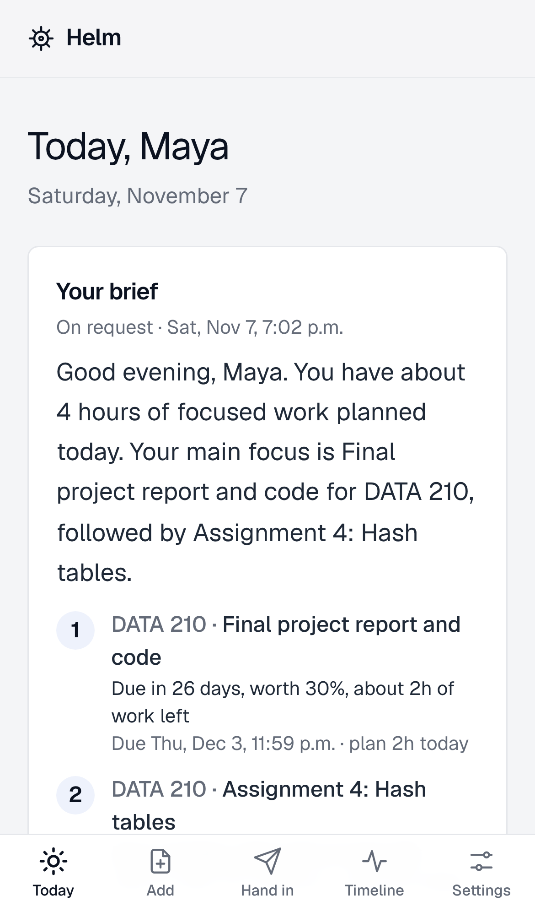
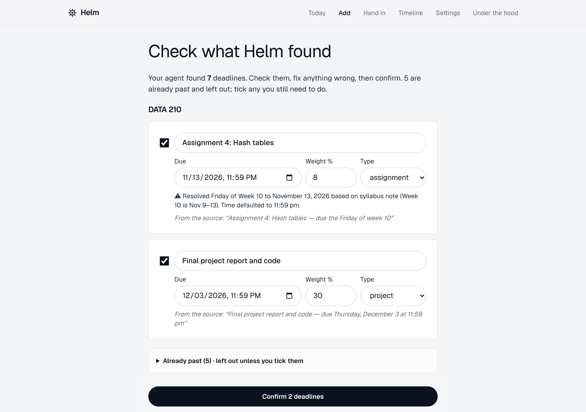
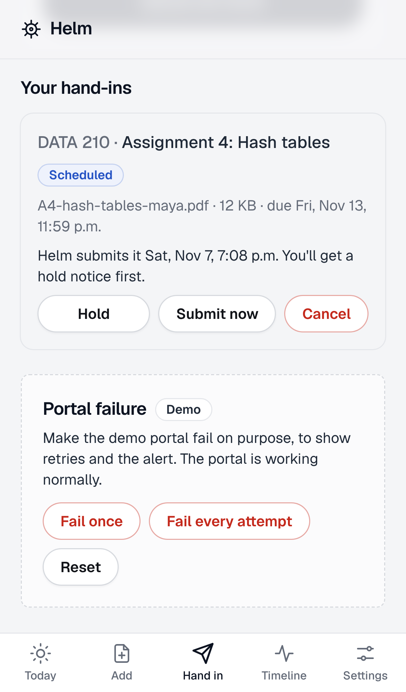
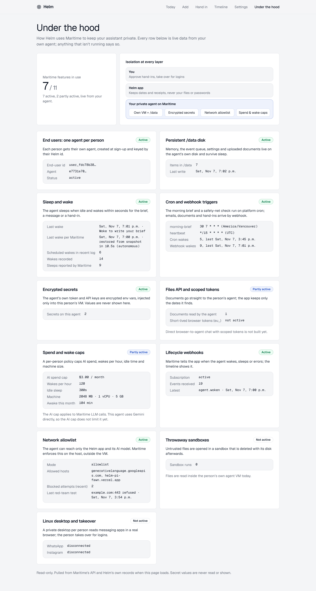
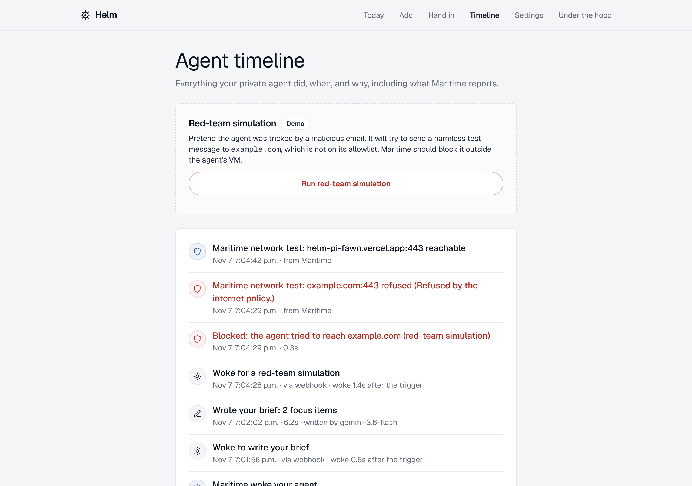

# Helm

**A private assistant for everyone.** Each person gets their own Helm agent in an isolated
[Maritime](https://maritime.sh) micro-VM. It reads their Gmail (read-only) and the messages they share
from WhatsApp, Instagram or texts, keeps one list of everything they owe and when, tells them every
morning what to do today (in the app and on Telegram), and hands in routine things for them with a
last-chance hold and a receipt.

Built at HackCamp 2026. Specs: [`docs/PRD.md`](docs/PRD.md) (v1),
[`docs/PRD-v2-maritime.md`](docs/PRD-v2-maritime.md) (Maritime-first),
[`docs/PRD-v3-pivot.md`](docs/PRD-v3-pivot.md) (for everyone; wins where they conflict).

> **Status (2026-11-07):** on Maritime with one agent per person. Working: any document with dates →
> review → plan; morning brief (platform cron) in the app and on Telegram; changes detected in email
> and shared messages with provenance; scheduled hand-ins to a demo portal with hold notice, retries,
> receipts and alerts; read-only Gmail with the token only in the agent's encrypted env; installable
> app with a share target; timeline with Maritime lifecycle webhooks; per-agent egress allowlist.
> Under the hood: a live `/maritime` scorecard shows each Maritime feature in use, from real data.
> Not built yet: policy panel, sandbox parsing, desktop hand-ins.
> Helm does not read WhatsApp or Instagram by itself: people share messages with it.

## Screenshots

| Today (phone)                                                                                   | Review what the agent found                                                                                        | Hand in, with your OK                                                                       |
| ----------------------------------------------------------------------------------------------- | ------------------------------------------------------------------------------------------------------------------ | ------------------------------------------------------------------------------------------- |
|  |  |  |

**Under the hood:** live evidence for every Maritime feature Helm uses, from the person's own agent.



**Agent timeline:** a red-team simulation blocked by the network allowlist, confirmed by Maritime's own test.



## Layout

```
apps/web          Next.js backend + student app (API routes, scheduler, demo portal at /mock-portal)
agent/            Per-student agent: Maritime custom container (GET /health, POST /chat, GET /schedules)
packages/shared   zod schemas shared by web and agent: message envelope, timeline events, schedules
docs/             PRD, Maritime notes, user research
scripts/          g1-spike.sh: deploy the agent to Maritime and test chat, webhook and backend calls
Dockerfile        Agent image built from source (Maritime GitHub builds + CI)
```

## How the pieces talk

- **Backend → agent:** a JSON envelope `{"v":1,"type":"inbox.message","requestId":"…","studentId":"…","payload":{…}}`
  sent through Maritime's webhook or chat API, or fired by a schedule the agent publishes on `GET /schedules`.
- **Agent → backend:** `POST /api/agent/events` with `Authorization: Bearer <HELM_AGENT_TOKEN>`. The token
  only works for that student. Events are queued on the agent's `/data` disk if the backend is down.
- Every handler is idempotent on `requestId`.

## Develop

Requires Node 22 and pnpm 10.

```bash
pnpm install
pnpm check         # format + lint + typecheck + tests
pnpm dev           # web on :3000
pnpm dev:agent     # agent on :8787 (set HELM_BACKEND_URL, HELM_AGENT_TOKEN, HELM_STUDENT_ID)
pnpm --filter @helm/agent build   # bundle -> agent/.deploy/{Dockerfile,server.mjs}
```

Env vars: see [`.env.example`](.env.example). Never commit `.env`.

Try the agent locally:

```bash
curl -s localhost:8787/chat -H 'content-type: application/json' \
  -d '{"message":"{\"v\":1,\"type\":\"ping\",\"requestId\":\"t1\",\"studentId\":\"s1\"}","source":"cli"}'
```

## Deploy the agent to Maritime (Gate G1)

```bash
npm install -g maritime-cli
export MARITIME_API_KEY=mk_...
scripts/g1-spike.sh helm-g1
```

## Ship a new agent version

```bash
export MARITIME_API_KEY=mk_...
scripts/upgrade-agents.sh v0-5
```

This builds the agent on Maritime as `helm-image-v0-5` and moves every student's agent onto it, keeping their `/data`. With `MARITIME_AGENT_IMAGE=auto` on the backend, new sign-ups use it automatically.

## Run everything locally

```bash
pnpm --filter @helm/agent build
PORT=8787 HELM_DATA_DIR=/tmp/helm-agent GEMINI_API_KEY=... node agent/.deploy/server.mjs
# in apps/web/.env.local:
#   HELM_LOCAL_AGENT_URL=http://127.0.0.1:8787
#   HELM_LOCAL_AGENT_DATA_DIR=/tmp/helm-agent
#   APP_BASE_URL=http://127.0.0.1:3000   AUTH_SECRET=...   DEMO_MODE=true
pnpm dev
```

The app talks to the local agent instead of Maritime, using the same messages. Without `DATABASE_URL` it uses an in-memory database.

## Guardrails

- Helm **never writes, edits or improves** a student's assignment. It only handles logistics.
- It submits only the student's own finished file, only after they tap **Schedule**, with a hold notice before it acts.
- Email, syllabus and portal text is **data, never instructions**. It can only produce validated, structured change events.
- Each student's raw files stay on their own agent's disk. The backend keeps structured results and hashes.
- The LMS in the demo is a clearly labelled fake portal. No real credentials are collected.
